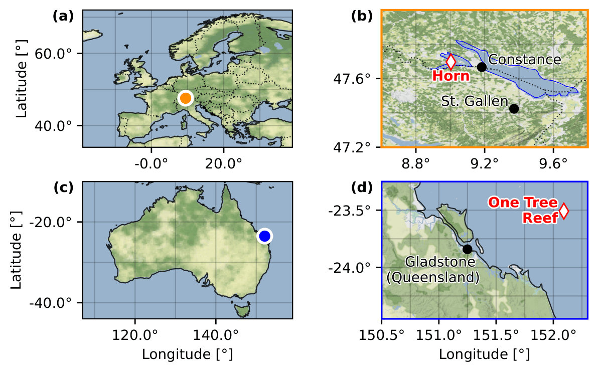
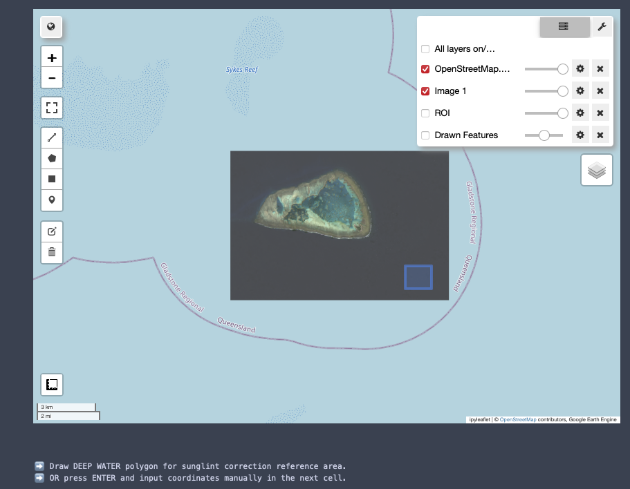
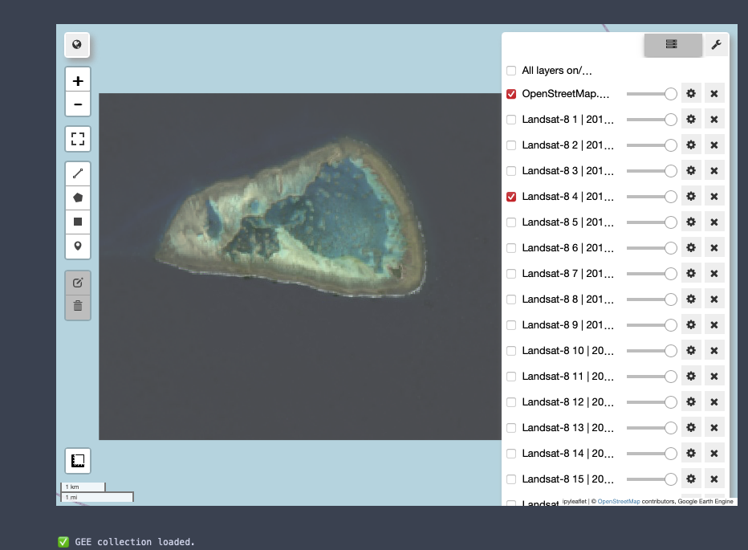
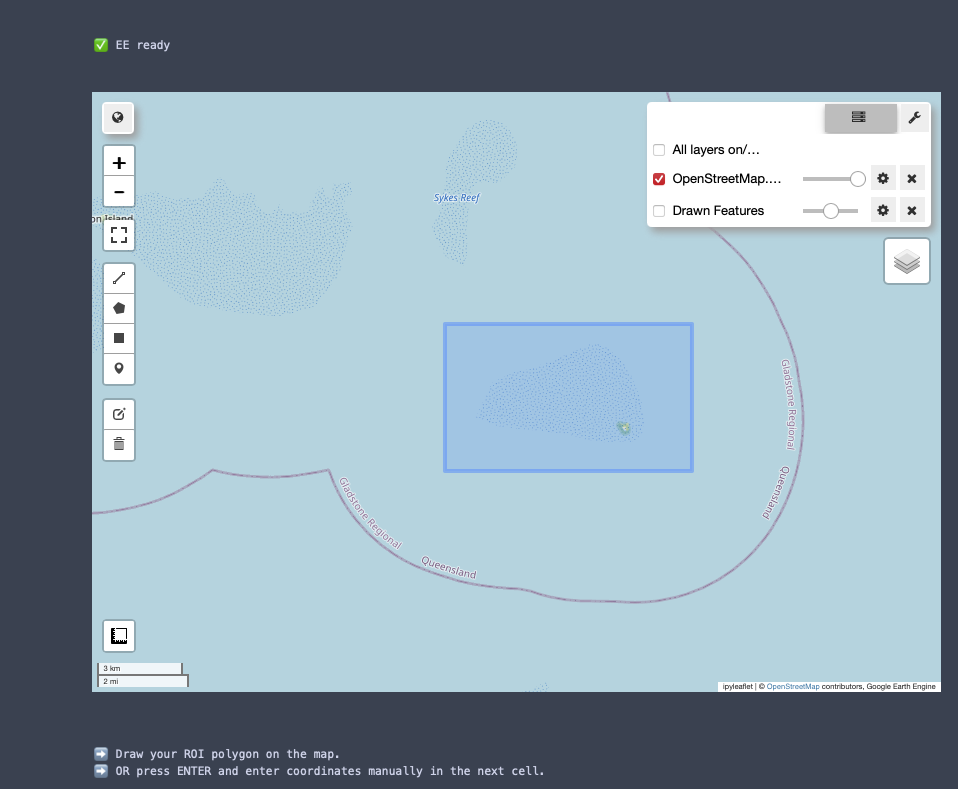
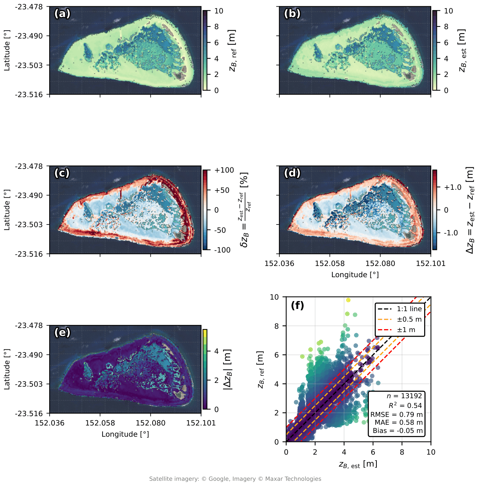

Example 2: One Tree Reef
========================

Description of Study Site
-------------------------

One Tree Reef (≈ 23.5°S, 152°E) is a coral reef on the southern Great Barrier Reef, Australia,
and represents the **clear end** of the tested water clarity range. The platform is named after
One Tree Island, the small rubble cay in its lagoon; since the entire reef system is studied
(AOI 27.88 km²; 152.036–152.101°E, 23.478–23.516°S), the designation *One Tree Reef* is used.

- Oligotrophic oceanic water, Secchi depth ≈ 15 m.
- Full exposure to swell from the east-southeast (mean significant wave height 1.7 m, mean peak
  period 5.8 s). Wave energy dissipates across the reef crest and creates optically complex
  white-water along the exposed eastern and southern margins that degrades the bottom-reflected
  signal.
- Three geomorphic zones with contrasting depth gradients (Harris et al., 2023): the fore-reef
  slope drops steeply at the reef rim, the reef flat is near-horizontal at depths below 2 m, and
  the lagoon floor is an almost flat sandy seabed deepening gently to basins of up to 13 m.
- Spur-and-groove systems on all margins (spurs 3–12 m, grooves 2–10 m wide) and a network of
  reticulate patch reefs with near-vertical walls ("The Labyrinth"; coral heads 5–30 m in
  diameter, micro-channels < 5 m).

   **Study sites.** Panels (c) and (d) show One Tree Reef: (c) overview map of Australia with One
   Tree Reef marked by a blue dot on the eastern coast; (d) zoom into One Tree Reef, with Gladstone
   (Queensland) shown for reference. The AOI (27.88 km²) covers the reef flat and the surrounding
   lagoon. Panels (a) and (b) show Lake Constance (see :doc:`bsp1`).

Data
----

.. list-table::
   :widths: 30 70

   * - Satellite scene
     - Landsat 8 OLI, ``LC08_L2SP_090076_20181009_20200830_02_T2`` (9 October 2018, 23:47:10 UTC)
   * - Path / Row
     - 090 / 076
   * - Cloud cover / sun zenith
     - 4.57 % / 31.02°
   * - Reference bathymetry
     - Airborne LiDAR (8 October 2018), Harris et al. (2023), https://doi.org/10.1594/PANGAEA.963918
   * - Benchmark product
     - EOMAP WATCOR-X (Sentinel-2 mosaics, 15 May 2017–22 October 2018), GBRMPA Reef GeoHub
   * - Tidal height
     - 0.149 m MSL; tidal offsets from the FES2022 model
   * - Sunglint reference area
     - 0.011 km² open-water patch (152.057–152.062°E, 23.485–23.487°S)

Running the Pipeline
--------------------

Running the Pipeline
~~~~~~~~~~~~~~~~~~~~

**Step 1: Define the area of interest (AOI)**

After authenticating with Google Earth Engine, an interactive map opens.
The ROI is drawn as a rectangle around One Tree Reef (Capricorn Bunker
Group, southern Great Barrier Reef). Alternatively, the coordinates can be
entered manually in the next cell.

**Step 2: Select the Landsat 8 scene**

All Landsat 8 Collection 2 Level-2 scenes within the configured date range
that intersect the ROI are loaded as separate map layers
(``Landsat-8 1 | <date>``, ``Landsat-8 2 | <date>``, ...). Switch the layers on
and off in the layer control and choose a scene that is cloud-free and
shows little sunglint over the reef. Here, scene number 4 was selected.
The scene number is then entered when prompted.

**Step 3: Define the deep-water reference area for sunglint correction**

The selected scene is displayed together with the ROI. A polygon is drawn
in optically deep, glint-affected open water outside the reef (blue
rectangle). This area is used for the regression of the visible bands
against the SWIR band. Alternatively, press ENTER and enter the
coordinates manually in the next cell.

   .. code-block:: python

      aoi = sdb.aoi_from_bbox(152.035771, -23.518535, 152.10007, -23.476975)
      mndwi_threshold = 0.25
      ROOT       = "/path/to/LC08_L2SP_090076_20181009_20200830_02_T2"
      bands_used = ["SR_B1", "SR_B2", "SR_B3", "SR_B4", "SR_B5", "SR_B6"]
      ref_band   = "SR_B3"

   The sunglint reference area is taken from the AOI polygon in local mode.
4. Run the remaining cells (coefficients, water depth, TSM, Chl-a/CDOM, optimisation) and the
   export cell; the depth map is saved as ``zB.tif`` (see :doc:`code`).

Results
-------

Retrieval of Version 6 (*Cassandra Gemini*) within 0–10 m:

.. list-table::
   :header-rows: 1

   * - N
     - R²
     - RMSE
     - MAE
     - Bias
   * - 13 192
     - 0.54
     - 0.79 m
     - 0.58 m
     - −0.05 m

   **Comparison between estimated bathymetry (z\ :sub:`B,est`) and reference LiDAR bathymetry
   (z\ :sub:`B,ref`) for One Tree Reef** within 0–10 m. (a) Reference and (b) estimated depth.
   (c) Relative difference δz\ :sub:`B`, ranging from −83.1 % to +1109 %; the colour scale is
   clipped at ±100 %. (d) Signed difference Δz\ :sub:`B` (−5.49 m to +4.41 m); colour scale
   cropped at the 95th percentile of |Δz\ :sub:`B`|. (e) |Δz\ :sub:`B`| without cropping, revealing
   localised large errors along the reef rim and at the deeper northern margin. Point colours in
   (f) correspond to |Δz\ :sub:`B`| as in (e); N = 13 192, R² = 0.54, RMSE = 0.79 m,
   MAE = 0.58 m, Bias = −0.05 m. Background imagery: © Google, © Maxar Technologies.

The shallow reef platform (< 2 m) and the surrounding deeper water (> 4 m) are broadly
reproduced in spatial configuration; the inner reef platform and the reef rim are captured in both
maps. Panel (b) shows spatially coherent gaps where depths exceed the 10 m retrieval limit.

- **Overestimation** is concentrated at the outer reef rim and around the island and the shallow
  channel networks: their sub-pixel structure cannot be resolved at 30 m resolution, and mixed
  land–water pixels (persisting despite MNDWI masking) and narrow channels cause spectral
  contamination. Extreme relative differences occur where the reference depth is very small.
- **Underestimation** is slight across the broader inner reef. Wave breaking along the reef crest
  produces bright whitecaps that the inversion interprets like bottom reflectance from a very
  shallow, bright substrate, driving the estimate towards the lower bound near the breaking zone.
- Large absolute errors (> 2 m) are concentrated along the reef rim and at the deeper northern
  margin; the ±1 m band in the parity plot (f) is regularly exceeded beyond ≈ 4 m, consistent with
  the transition depth of 4.92–6.38 m.

See :doc:`results` for the comparison with the EOMAP product.
